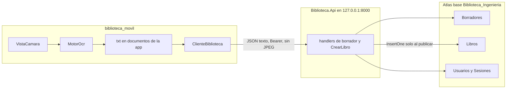
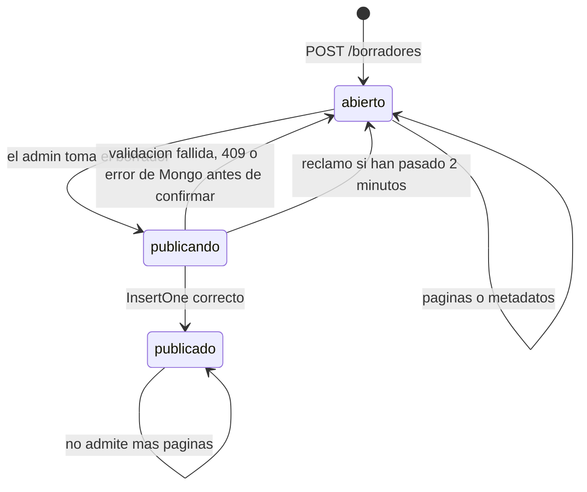

# Subir páginas escaneadas a MongoDB vía Biblioteca.Api

| Campo | Valor |
| --- | --- |
| Autor | Por definir |
| Fecha | 2026-11-04 |
| Estado | Draft |
| Alcance | Diseño. No implementa código. |
| Repositorio | raíz de `script_biblioteca` |

## Overview

El escáner de `biblioteca_movil` reconoce texto en el teléfono y lo deja en un `.txt` privado. Ese texto no entra en MongoDB salvo que un admin arme un libro entero y llame a `POST /libros`. Un lector no puede añadir una página corregida más tarde, y no debe poder hacer `InsertOne` en la colección `Libros`.

La propuesta es una colección nueva, `Borradores`, en la misma base `Biblioteca_Ingenieria`. El teléfono, después de que la persona corrige el OCR, manda solo el texto a `Biblioteca.Api`. La API escribe el borrador. `Libros` no cambia hasta que un admin publica: ese paso reutiliza `CrearLibro.Validar` y `CrearLibro.Armar` y termina en el `InsertOne` que ya existe. Si el `_id` del catálogo está ocupado, la respuesta sigue siendo 409 y el documento de `Libros` no se toca.

No hay un segundo cliente de Mongo en Flutter, no se sube el JPEG, no se habla con `dev-api` y Kestrel sigue en loopback.

## Background & Motivation

Hoy el recorrido de una página es local. `VistaCamara` toma la foto, `MotorOcr.reconocer` (`biblioteca_movil/lib/funciones/escaner/motor_ocr.dart`) corre ML Kit en alfabeto latino y borra el JPEG en un `finally`. La persona corrige el texto. `GuardarTexto.guardar` (`guardar_texto.dart`) escribe UTF-8 en `getApplicationDocumentsDirectory` con un nombre `^[A-Za-z0-9_-]{1,80}$`. `CasosEscaner` no tiene cliente HTTP. `ClienteBiblioteca` solo habla con `Biblioteca.Api` y, para escribir catálogo, solo expone `crearLibro`, que hace `POST /libros`.

Ese POST está cerrado. `CrearLibro.Mapear` exige `Politicas.SoloAdmin` y `Limites.Escritura`. La política de reserva en `ServiciosSeguridad` pide un usuario autenticado en todo lo demás. Un lector recibe 403; `PantallaPublicar` ni siquiera muestra el formulario si `usuario.rol` no es `admin`. El cuerpo es una `Solicitud` con la lista completa `paginas` en orden. `Armar` construye `Pagina { numero_pagina, texto_completo, conteo_palabras }`, `caracteres_totales` (runas Unicode, no `string.Length`) y `total_paginas`, y hace `InsertOne` en `Libros`. Un `_id` repetido sale por `MongoWriteException` de clave duplicada y responde 409 sin actualizar. No hay PUT, PATCH ni DELETE. El tope son 5000 páginas y 15 MB de cuerpo, porque un documento de Mongo no puede pasar de 16 MB. El id de catálogo cumple `^[a-z0-9][a-z0-9_]{2,99}$` y el idioma `^[a-z]{2,3}$`.

Eso encaja con un libro ya terminado. No encaja con el escáner: una página corregida no se puede anexar, y abrir `POST /libros` a todo `lector` metería páginas sueltas en el catálogo público. El otro atajo, un driver de Mongo en el teléfono, pondría `MONGO_URI` en el aparato y saltaría JWT, roles y `Armar`.

El pipeline de Python no es el camino del teléfono. `pipeline_mongo.py` hace `update_one({_id}, {$set: documento con _id}, upsert=True)` sobre `Biblioteca_Ingenieria.Libros`. Un segundo upsert del mismo libro puede fallar con el error 66 de Mongo porque `_id` es inmutable. Ordena las páginas por nombre de archivo. Un libro malo no corta el lote. Este diseño no cambia esa base ni ese script.

`dev-api` (`dev-api/server.mjs`) también escucha en el puerto 8000 y solo lee `Libros`. El teléfono no debe usarlo. El perfil `http` de Kestrel escucha en `http://127.0.0.1:8000` (`Properties/launchSettings.json`). El aparato llega por `adb reverse` a `http://127.0.0.1:8000`, o el emulador por `10.0.2.2` (`ClienteBiblioteca.basePorDefecto`). Eso es entorno, no un bind a `0.0.0.0`. En Development la cookie de refresco usa `RutaCookie` `/api/auth` mientras la ruta es `/auth/refrescar`; el móvil manda la cookie a mano. Este diseño no toca `RutaCookie`.

La carga prevista es de aula, no de servicio público: del orden de los tres libros ya medidos (43, 59 y 71 páginas; unos 96–149 mil caracteres) y sesiones de un teléfono. Una página OCR corregida cabe en unos pocos KiB. El presupuesto de diseño es menos de 50 borradores abiertos en total, menos de 200 páginas por borrador en el caso normal, y el peor caso ya acotado por las reglas del libro (5000 páginas, documento por debajo de 16 MB).

## Goals & Non-Goals

### Goals

- Una página corregida sale del teléfono y queda en Mongo, escrita por `Biblioteca.Api` en el PC.
- El catálogo `Libros` sigue siendo solo libros publicados. Un `lector` no gana `InsertOne`.
- El teléfono sube texto ya corregido. El JPEG no viaja.
- Reintentar tras una respuesta perdida no crea una segunda copia de la misma página.
- El borrador es del usuario del JWT (`sub`, el `ObjectId` de `Usuarios` que pone `GestorSesiones.CrearJwt`). Otro lector no lo lee ni lo edita. Un admin puede listarlo para publicarlo.
- Publicar llama a `CrearLibro.Armar` / `Validar` y a `InsertOne`. El documento publicado coincide con `modelo_libro.json` más `total_paginas`, que la API ya guarda y el pipeline no. Un `_id` existente responde 409 y no se modifica.
- El `.txt` local permanece si la API no confirma el guardado.
- La API sigue en solo GET y POST, con límite de peticiones en cada ruta (`AutorizacionTests.Todas_las_rutas_tienen_limite_de_peticiones` falla si falta).
- Las rutas nuevas no son anónimas (`Solo_registro_login_y_sesion_se_pueden_usar_sin_token`).

### Non-Goals

- No se implementa código en este documento.
- No se añade driver de Mongo, `MONGO_URI` ni `JWT_CLAVE` al teléfono.
- No se cambia `pipeline_mongo.py`, su base `Biblioteca_Ingenieria` ni su colección `Libros`.
- No se añade PUT, PATCH ni DELETE, ni edición de un libro ya insertado.
- No se arregla el error 66 del pipeline. Sigue siendo un riesgo aparte si alguien reinyecta un `_id` que la API ya publicó.
- No se mueve Kestrel a `0.0.0.0`, no se cambia `RutaCookie` y no se enruta el teléfono hacia `dev-api`.
- No se sube imagen, PDF ni audio. No se mueve el OCR al servidor.
- No se crea una cola, un worker ni un segundo proceso. El handler escribe en el mismo request.
- La web de Vite y `dev-api` no ganan pantalla de borradores. Un borrador no aparece en `GET /libros` hasta el `InsertOne`.

## Proposed Design

### Idea

Un borrador es un documento de trabajo en `Borradores`, con las páginas embebidas. No es un `Libro`. El teléfono identifica cada página con la misma clave que ya usa como nombre de archivo. La API aplica esa clave una sola vez dentro del documento. Publicar es otro request, solo admin, que ordena esas páginas, construye la `Solicitud` de `CrearLibro` y hace el `InsertOne` de siempre.

Una sola colección basta. El teléfono es de una persona, así que dos escrituras concurrentes del mismo borrador son raras. La contención se resuelve con un entero `revision` y `ReplaceOne` condicional, no con una colección de páginas ni con una transacción multi-documento.



`dev-api` no está en el dibujo. Sigue leyendo únicamente `Libros`.

### Del disparo al catálogo

```mermaid
sequenceDiagram
    participant U as Persona
    participant Cam as VistaCamara
    participant Ocr as MotorOcr
    participant Disco as GuardarTexto
    participant Cli as ClienteBiblioteca
    participant Api as Biblioteca.Api
    participant Bor as Borradores
    participant Lib as Libros

    U->>Cam: elige o crea un borrador
    Cam->>Cli: POST /borradores
    Cli->>Api: clave_cliente, Bearer
    Api->>Bor: insert o lectura del mismo par usuario+clave
    Api-->>Cam: id del borrador
    U->>Cam: captura
    Cam->>Ocr: reconocer jpeg
    Ocr-->>Cam: texto; el JPEG ya se borró
    U->>Cam: corrige y pulsa Guardar
    Cam->>Disco: escribe nombre.txt
    Note over Disco: si esto falla, no hay POST
    Cam->>Disco: escribe nombre.destino.json
    Cam->>Cli: POST /borradores/id/paginas
    Cli->>Api: clave, orden, texto
    Api->>Bor: ReplaceOne si revision coincide
    Api-->>Cli: 200
    Cli-->>Disco: escribe nombre.subido.json
    Note over Cam,Lib: más tarde, un admin
    U->>Cli: POST /borradores/id/publicar
    Cli->>Api: metadatos de catálogo, sin reenviar páginas
    Api->>Bor: pasa a publicando y relee páginas
    Api->>Api: CrearLibro.Validar y Armar
    Api->>Lib: InsertOne
    Api->>Bor: estado publicado y libro_id
    Api-->>Cli: 201 ResumenLibro
```

Latencia objetivo, sin contar el OCR ni la corrección humana: el upsert de una página típica (documento de borrador menor de 1 MB, ida a Atlas desde el PC) en menos de 500 ms en p95. Publicar un borrador de unas 200 páginas, un `InsertOne` de unos pocos cientos de KB, en menos de 1 s en p95. El tramo del teléfono al API es loopback vía `adb reverse` o `10.0.2.2`; el tiempo variable es Atlas, no un bind en la LAN. El cuerpo por defecto de Kestrel sigue en 1 MB (`Program.cs`, `MaxRequestBodySize`). Una página no usa el tope de 15 MB de `POST /libros`.

### Estados del borrador



`publicando` evita dos `InsertOne` paralelos del mismo borrador. No evita el 409 si ese `_id` ya está en `Libros` por el pipeline o por otro `POST /libros`: en ese caso se vuelve a `abierto` y `Libros` queda como estaba.

Si el proceso muere después del `InsertOne` y antes de marcar `publicado`, el borrador se queda en `publicando`. A los 2 minutos otro `POST .../publicar` puede reclamarlo. El `InsertOne` reintenta y, si el libro sí se escribió, responde 409. El admin ve el libro con `GET /libros/{id}`. No se ata el borrador al libro existente solo porque el `_id` coincida: podría ser el de `pipeline_mongo.py`, y el 409 actual no fusiona páginas. Severidad baja. La mitigación es el mensaje de 409 ya usado por `CrearLibro` (`Ya existe un libro con el id {id}.`) y el catálogo, que no se pisa.

### Contrato de idempotencia

La clave de página es el nombre del archivo, sin `.txt`, con la misma expresión que `nombreDeTextoValido`: `^[A-Za-z0-9_-]{1,80}$`. No se pasa a minúsculas. `GuardarTexto` ya sobrescribe el mismo path si el nombre se repite; el servidor debe hacer lo mismo.

La función pura, testeable sin Atlas, es la única que mete o reemplaza una página:

```csharp
internal static class PaginasBorrador
{
    public static bool Aplicar(List<PaginaBorrador> paginas, string clave, int orden, string texto, DateTime ahora)
    {
        var indice = paginas.FindIndex(p => p.Clave == clave);
        if (indice >= 0)
        {
            paginas[indice].Orden = orden;
            paginas[indice].Texto = texto;
            paginas[indice].ActualizadoEn = ahora;
            return false; // ya estaba
        }

        paginas.Add(new PaginaBorrador { Clave = clave, Orden = orden, Texto = texto, ActualizadoEn = ahora });
        return true;
    }
}
```

Llamarla dos veces con la misma `clave` deja un solo elemento y el texto de la última llamada. El handler no hace `$push` ciego.

La escritura en Mongo es un documento entero condicionado por la revisión:

```csharp
var filtro = Builders<Borrador>.Filter.And(
    Builders<Borrador>.Filter.Eq(b => b.Id, borrador.Id),
    Builders<Borrador>.Filter.Eq(b => b.UsuarioId, usuarioId),
    Builders<Borrador>.Filter.Eq(b => b.Revision, revisionLeida),
    Builders<Borrador>.Filter.Eq(b => b.Estado, EstadosBorrador.Abierto));

borrador.Revision = revisionLeida + 1;
borrador.ActualizadoEn = ahora;
var resultado = await bd.Borradores.ReplaceOneAsync(filtro, borrador, cancellationToken: ct);
```

`UsuarioId` va siempre en el filtro de las rutas del dueño. Si `ModifiedCount` es 0, se relee y se reaplica `Aplicar` hasta 3 veces. Si ninguna entra, se responde 409 con título `El borrador cambió. Vuelve a intentar.` y no se borra el `.txt`. Una respuesta perdida que sí se aplicó, al reintentarse, encuentra la misma clave y vuelve a escribir el mismo texto: sigue siendo una página.

`ReplaceOne` reescribe el documento. Con el tamaño de aula (documento menor de 1 MB) es aceptable. El peor caso, cerca de 14 MB, es el mismo orden que un `POST /libros` de hoy y sigue por debajo del límite de 16 MB.

El alta del borrador es idempotente por el índice único `(usuario_id, clave_cliente)`. La `clave_cliente` la genera el teléfono una vez y la guarda en `shared_preferences`, junto al `id` que devuelve la API. No es un secreto y no va al JWT ni a `flutter_secure_storage`. Si el `InsertOne` choca por clave duplicada, se lee el documento de ese par y se responde 200 con el mismo `id`. Un reintento no crea un segundo borrador ni pisa el `titulo` que ya se guardó. El título se cambia después con `POST .../metadatos`.

### Qué guarda el teléfono hasta la confirmación

`GuardarTexto.guardar` sigue escribiendo el `.txt` antes de cualquier red. A partir de ahí hay dos marcas locales, las dos fuera del filtro `.txt` de `GuardarTexto.listar` (ese método solo recoge `*.txt`):

| Archivo | Cuándo se escribe | Significado |
| --- | --- | --- |
| `{nombre}.txt` | Al pulsar Guardar, antes del POST | Texto corregido. No se borra si el POST falla, si se pierde la respuesta o si no hay sesión. |
| `{nombre}.destino.json` | Justo después del `.txt`, si hay un borrador elegido | Intención: `borrador_id`, `clave`, `orden`. Todavía no es un acuse. |
| `{nombre}.subido.json` | Solo tras HTTP 200 | Acuse: `borrador_id`, `clave` y una huella FNV-1a 64 del texto, calculada en el cliente sin paquete nuevo. |

No hay `package:crypto` en `pubspec.yaml`. FNV-1a 64 es un detector de cambio local, no una firma. Si el usuario vuelve a guardar y la huella no coincide, se borra solo el `.subido.json`, se mantiene el `.txt` y el `.destino.json`, y se repite el POST con la misma clave.

Si no hay borrador activo, el `.txt` se guarda igual y la pantalla dice que falta elegirlo. No se adivina el borrador por el prefijo del nombre: dos libros no deben mezclarse porque el archivo estaba sin marca. «Subir pendientes» recorre los `.txt` que tienen `.destino.json` y no tienen un `.subido.json` con la misma huella, y los manda de uno en uno al `borrador_id` de esa marca. El cliente ya reintenta un 429 una vez (`ClienteBiblioteca._conTope`) y un 401 refresca una sola vez (`enviar`). Si el segundo intento falla, el archivo sigue en el teléfono.

El JPEG no entra en este recorrido. `MotorOcr` lo borra antes de la pantalla de revisión, igual que ahora.

### Publicar reutilizando CrearLibro

`Validar` y `Armar` pasan de `private` a `internal`. No se copia `ContarPalabras` ni el cálculo de runas. `PublicarBorrador` arma una `CrearLibro.Solicitud` cuyo campo `Paginas` es la lista de textos ya ordenada, y llama a esos dos métodos. `CrearLibro.Manejar` no se modifica en su contrato: sigue siendo el alta de un libro completo para el admin que todavía publica desde los `.txt` locales (`PantallaPublicar` y `CasosCatalogo.publicar`).

Orden, si el cuerpo no trae `claves`: `orden` ascendente y, a igualdad, `clave` ordinal (`StringComparer.Ordinal`). No es el orden lexicográfico de `pipeline_mongo.py`. No hace falta que lo sea: aquí el admin fija el orden, igual que hoy reordena archivos en `PantallaPublicar`. Si el cuerpo trae `claves`, tiene que ser una permutación exacta de las claves guardadas. Si falta o sobra alguna, 400 en el campo `claves` y el borrador no sale de `abierto`.

Antes de `InsertOne` se rechaza el armado si `bytes_texto` más un margen de 64 bytes por página más 1 KiB de metadatos pasa de `CrearLibro.TamanoMaximo` (15 MiB). `POST /libros` confía en el límite de Kestrel porque el cuerpo es el documento. Aquí el cuerpo de publicar es solo metadatos; el documento grande se monta en el servidor y hay que medirlo ahí. Respuesta 413, borrador otra vez `abierto`.

Tope de páginas: el de `CrearLibro`, 5000. Tope de texto acumulado en el borrador: 14 MiB (`14 * 1024 * 1024`), para dejar sitio al overhead de BSON y no chocar con los 16 MB dentro de `ReplaceOne`. Tope de una página: 256 KiB en UTF-8. Una página de OCR real está muy por debajo; el tope evita que una sola petición de 1 MB se coma el borrador. Texto vacío está permitido, porque `Validar` ya rechaza `null` pero no `""`.

Al pasar a `publicado` se guardan `libro_id` (el `_id` de catálogo que sí se insertó) y no se aceptan más páginas ni metadatos: 409 `Este borrador ya se publicó como {libro_id}.` El `.txt` del teléfono no se borra por eso. El duplicado de texto (borrador más `Libros`) para 50 borradores de 200 páginas a 8 KiB es del orden de 160 MB contando las dos copias. Cabe en el uso de aula. No hay TTL en esta versión.

`libro_id_propuesto` es opcional en el borrador. Si viene, cumple el regex de `CrearLibro.FormatoId`. No se escribe en `Libros`. El admin lo ve rellenado en el formulario; el `id` del cuerpo de publicar es el que manda.

### Autorización

El `sub` del JWT es `usuario.Id.ToString()` (`GestorSesiones`). Se compara como string con `Borrador.UsuarioId`. No se vuelve a leer `Usuarios` en cada página.

| Acción | Anónimo | Lector dueño | Otro lector | Admin no dueño | Admin dueño |
| --- | --- | --- | --- | --- | --- |
| `POST /borradores` | 401 | 201 o 200 | 201 o 200 del suyo | igual que lector | igual que lector |
| `GET /borradores` | 401 | solo los suyos | solo los suyos | solo los suyos | solo los suyos |
| `GET /borradores?alcance=todos` | 401 | 403 | 403 | listado de todos | listado de todos |
| `GET /borradores/{id}` | 401 | 200 con texto | 404 | 200 con texto | 200 con texto |
| `POST .../paginas` y `.../metadatos` | 401 | 200 | 404 | 404 | 200 |
| `POST .../publicar` | 401 | 403 | 403 | 201, 409 o 400 | 201, 409 o 400 |
| `POST /libros` | 401 | 403 | 403 | como hoy | como hoy |

404 y no 403 cuando el borrador existe pero el caller no es dueño ni admin de lectura. Un `ObjectId` no se adivina, y un 403 distinguiría «existe» de «no existe». `alcance=todos` en un lector sí es 403: es una acción que el cliente pidió de más, no un sondeo de ids.

El admin no edita el texto de un borrador ajeno. Puede leerlo para publicarlo y puede imponer orden y metadatos de catálogo en el POST de publicar. Si el texto está mal, lo corrige el dueño con la misma clave; el upsert sustituye el texto. Así un admin no se convierte en editor oculto de apuntes de otra persona, y `Libros` solo recibe lo que el dueño dejó guardado más los metadatos que el admin asume al publicar.

### Cliente Flutter

`ClienteBiblioteca._unaVez` solo conoce GET y POST. Las rutas nuevas respetan eso; no se añade PUT. Sigue habiendo un solo `http.Client`, creado en `main.dart`.

`CasosEscaner` hoy se construye sin cliente (`main.dart`). Pasa a recibir `ClienteBiblioteca`, igual que `CasosCatalogo`. `MotorOcr` y `GuardarTexto` siguen inyectables para las pruebas que ya existen (`guardar_texto_test.dart`).

El borrador activo vive en `shared_preferences` (`borrador_id`, `borrador_clave_cliente`), el mismo sitio que `ProgresoLocal`, no en el almacén seguro de la cookie. Hace falta una pantalla corta, ruta nueva `/borradores`, para crear uno o elegir uno abierto. El catálogo ya exige sesión (`Puerta` manda a `/login` si no hay refresco). El botón de escanear puede seguir en `PantallaCatalogo`; antes de la cámara, si no hay borrador activo, se abre el selector.

`PantallaPublicar` no se tira. Sigue sirviendo para el admin que tiene los `.txt` en ese teléfono y llama a `POST /libros`. Se añade otra entrada, solo si `esAdmin`, que lista `alcance=todos` y publica un borrador sin volver a enviar las páginas. La ficha de revisión pide `GET /borradores/{id}` (ahí sí viaja el texto, para poder leerlo) y el POST de publicar manda solo metadatos. Un borrador de 100 páginas a 2 KiB son unos 200 KB, cómodos por `adb reverse`. El peor caso legal, cerca de 14 MB, es el mismo techo que el admin ya puede enviar en `POST /libros`.

### Límites

Nueva política `Limites.Borrador`, ventana deslizante de 1 minuto como las demás, clave `PorUsuario`. Valor en `appsettings.json`: 60 por minuto. Crear borrador, subir página y guardar metadatos usan esa política. Los GET usan `Limites.Lectura` (120). Publicar usa `Limites.Escritura` (20) y `Politicas.SoloAdmin`.

60 y no 20: al reconectar, el teléfono puede vaciar una cola de páginas ya corregidas. En régimen normal la corrección humana va a unas pocas páginas por minuto. El cliente ya espera `Retry-After` una vez. `Limites.Autenticacion` (5 por minuto por IP) no se toca. `Limites.Escritura` no se sube, para no aflojar `POST /libros` ni `AsignarRol`.

Además del rate limit, como mucho 40 borradores en estado `abierto` por `usuario_id`. El número 41 responde 409. Los `publicado` no cuentan: si no, publicar liberaría cupo a costa de borrar historial, y no queremos borrar.

### Riesgos

| Riesgo | Severidad | Mitigación |
| --- | --- | --- |
| Un lector acaba escribiendo en `Libros` | Alta si se abre `POST /libros` | No se abre. Publicar es `SoloAdmin`. El 403 de lector se mantiene y se añade otro para `POST .../publicar`. |
| Dos copias de la misma página por un reintento | Alta si se hiciera `$push` | `Aplicar` por `clave` más índice único del borrador. El `.txt` solo se marca subido tras el 200. |
| El borrador de una persona lo lee otra | Alta | Filtro `usuario_id` en escritura. Lectura ajena: 404. Listado global solo con `alcance=todos` y rol admin. |
| `ReplaceOne` pisa un cambio concurrente | Media | Filtro por `revision`. Tres reintentos. La reaplicación es por clave, así que no duplica. |
| Publicar un `_id` que ya cargó el pipeline | Media | 409, `Libros` intacto, borrador vuelve a `abierto`. El admin elige otro id. No se fusionan páginas. |
| Muerte entre `InsertOne` y `publicado` | Baja | Estado `publicando`, reclamo a los 2 minutos, el reintento choca con 409 si el libro está. No se reescribe `Libros`. |
| El pipeline reinyecta ese `_id` y cae en el error 66 | Baja, ya existente | Fuera de alcance. No se cambia `pipeline_mongo.py`. Conviene no reutilizar el nombre de una carpeta de `Bulk_Upload_Texto_Test`. |
| Un lector llena Atlas de texto | Media | 40 abiertos, 5000 páginas, 14 MiB, 256 KiB por página, 60 peticiones por minuto. |
| El log o una traza guarda el texto escaneado | Media | Los logs nuevos no incluyen `texto`, correo ni JWT. Ver Observabilidad. |
| `GET` del borrador grande por el cable USB | Baja | El listado no lleva texto. El detalle sí, y solo dueño o admin. Mismo orden de magnitud que el POST de libro actual. |

## API / Interface Changes

JSON en snake_case, el de `ConfigureHttpJsonOptions` en `Program.cs`. El id del borrador viaja como `id` (24 hex del `ObjectId`). No se usa `_id` en este contrato: `_id` en las respuestas de catálogo es el id de `Libros` (`ResumenLibro` lleva `[JsonPropertyName("_id")]`). Aquí el id de catálogo, cuando existe, es `libro_id`.

Todas las rutas llevan `RequireRateLimiting` y ninguna lleva `AllowAnonymous`. Se registran desde un `MapBorradores` llamado en `Program.cs` al lado de `MapLibros`. No se meten dentro de `LibrosEndpoints`: no forman parte del contrato que `dev-api` imita.

### `POST /borradores`

Autenticado. Límite `borrador`.

```json
{ "clave_cliente": "celestina_nov4", "titulo": "La Celestina" }
```

`clave_cliente` es obligatoria: `^[a-z0-9][a-z0-9_-]{2,63}$`. `titulo`, si viene, 1–300 tras `Trim`, la misma regla que `CrearLibro`. 201 la primera vez, 200 si ese usuario ya tenía esa clave. Cuerpo de respuesta: resumen sin páginas (el esquema de aquí abajo). El 200 no actualiza el título.

### `GET /borradores?desde=0&estado=abierto`

Autenticado. Límite `lectura`. Como mucho 20, el mismo `ListarLibros.PorPagina`, orden `actualizado_en` descendente y `_id` como desempate. `estado` es `abierto`, `publicado` o ausente (los dos). Un valor raro es 400.

`alcance=todos` solo admin. Si no, 403. Con ese alcance el filtro de `usuario_id` se quita y el resumen incluye `usuario_id` y `nombre_usuario` para que el admin sepa de quién es. Sin ese alcance, la respuesta no repite el `usuario_id` de los demás porque no hay demás.

```json
{
  "borradores": [
    {
      "id": "6718f0c2a1b2c3d4e5f60718",
      "clave_cliente": "celestina_nov4",
      "titulo": "La Celestina",
      "estado": "abierto",
      "total_paginas": 3,
      "bytes_texto": 8400,
      "actualizado_en": "2026-11-04T18:00:00Z",
      "libro_id": null
    }
  ],
  "total": 1,
  "siguiente": null
}
```

Sin `texto`. `siguiente` funciona como en `ListarLibros`: null cuando no hay más.

### `GET /borradores/{id}`

Dueño o admin. Si no, 404. Límite `lectura`.

```json
{
  "id": "6718f0c2a1b2c3d4e5f60718",
  "clave_cliente": "celestina_nov4",
  "estado": "abierto",
  "titulo": "La Celestina",
  "autor": null,
  "idioma": null,
  "temas": [],
  "portada": null,
  "capitulos": [],
  "libro_id_propuesto": "004_la_celestina",
  "libro_id": null,
  "total_paginas": 2,
  "bytes_texto": 1200,
  "revision": 7,
  "paginas": [
    { "clave": "004_la_celestina_001", "orden": 1, "caracteres": 400, "texto": "Texto ya corregido." }
  ]
}
```

`paginas` sale ordenada por `orden` y luego `clave` ordinal. `caracteres` es el número de runas, el mismo criterio que `Armar`, para que el admin vea el tamaño antes de publicar. `revision` se devuelve para diagnóstico; el cliente no tiene que reenviarla. La concurrencia la resuelve el servidor.

### `POST /borradores/{id}/paginas`

Solo el dueño, y solo si `estado` es `abierto`. Límite `borrador`. Cuerpo por debajo del máximo de 1 MB.

```json
{ "clave": "004_la_celestina_012", "orden": 12, "texto": "Texto corregido." }
```

`orden` es un entero de 1 a 5000. Siempre se manda, también en el reintento, para no mover la página por un default distinto. Respuesta siempre 200 si la escritura quedó, tanto si la clave era nueva como si se sustituyó:

```json
{
  "id": "6718f0c2a1b2c3d4e5f60718",
  "clave": "004_la_celestina_012",
  "orden": 12,
  "resultado": "creada",
  "total_paginas": 4,
  "bytes_texto": 9000
}
```

`resultado` es `creada` o `actualizada`. El cliente trata cualquier 200 como acuse y escribe `.subido.json`. No usa 201, para que un reintento no dependa de distinguir el alta.

Errores: 400 si la clave, el orden o el texto no valen (`texto` null, clave fuera del regex, orden fuera de rango, página mayor de 256 KiB); 404 si no es el dueño o no existe; 409 si está `publicado`, `publicando`, se pasó el cupo de 5000 páginas o de 14 MiB, o se agotaron los reintentos de `revision`; 413 solo si Kestrel rechaza el cuerpo. El cupo de 14 MiB se responde 409 con campo `texto`, no 413, porque la petición en sí es pequeña: lo que no cabe es el documento acumulado.

### `POST /borradores/{id}/metadatos`

Solo el dueño, solo `abierto`. Límite `borrador`. Sustituye el bloque de metadatos que venga. Los campos ausentes no se tocan. `portada: null` la borra. No es un PATCH de HTTP; es un POST porque la API no tiene PATCH.

Campos admitidos: `titulo`, `autor`, `idioma`, `temas`, `portada`, `capitulos`, `libro_id_propuesto`. Cada uno, si viene, usa las reglas de `CrearLibro.Validar` (longitudes, https, capítulos con `numero >= 1` y título). `pagina_inicio` de un capítulo de borrador puede apuntar a una página que todavía no existe: el borrador está incompleto. Esa regla estricta (`pagina_inicio` dentro del libro) se aplica solo en `Validar` al publicar. `libro_id_propuesto` vacío se guarda como null; si no está vacío, tiene que cumplir `FormatoId`.

Respuesta 200 con el mismo resumen que el GET, sin repetir el texto de todas las páginas: `paginas` en esta respuesta lleva `clave`, `orden` y `caracteres`, no `texto`. Así un cambio de título no reenvía el libro por el cable.

### `POST /borradores/{id}/publicar`

`Politicas.SoloAdmin` y `Limites.Escritura`. El cuerpo es el de `POST /libros` sin `paginas`, más `claves` opcional:

```json
{
  "id": "004_la_celestina",
  "titulo": "La Celestina",
  "autor": "Rojas, Fernando de",
  "idioma": "es",
  "temas": ["Teatro"],
  "portada": "https://ejemplo.com/portada.jpg",
  "capitulos": [{ "numero": 1, "titulo": "Acto I", "pagina_inicio": 1 }],
  "claves": ["004_la_celestina_001", "004_la_celestina_002"]
}
```

Pasos del handler:

1. Leer el borrador. 404 si no existe.
2. Si `estado` es `publicado`, 409 y no se llama a `InsertOne`.
3. Si `estado` es `publicando` y `actualizado_en` tiene menos de 2 minutos, 409 `Ya hay una publicación en curso.`
4. Si `estado` es `publicando` y han pasado 2 minutos, se trata como reclamable.
5. `UpdateOne` condicional a `abierto` (o `publicando` vencido) con la `revision` leída: `estado = publicando`, `revision + 1`, `actualizado_en = ahora`. Si no modifica, 409 y se reintenta la lectura una vez.
6. Releer las páginas ya congeladas. Ordenar. Construir `CrearLibro.Solicitud`.
7. `Validar`. Si falla, volver a `abierto` y devolver el `ValidationProblem` de siempre.
8. `Armar`. Si la estimación pasa de 15 MiB, volver a `abierto` y responder 413.
9. `Libros.InsertOneAsync`. Clave duplicada: volver a `abierto`, 409 con el mismo título que `CrearLibro.Manejar`. Otro error de Mongo: volver a `abierto`, 503, sin borrar páginas.
10. `UpdateOne` de `publicando` a `publicado` con `libro_id`. Respuesta 201 y el mismo `ResumenLibro` que `POST /libros` (`Created` en `/libros/{id}`).

El cuerpo de publicar no incluye los textos. Quien implemente el cliente no debe «ayudar» reenviando `paginas` en este POST. El servidor las ignora si aparecieran: la fuente es el documento. Ignorarlas evita que un cliente viejo, o uno mal hecho, publique un subconjunto distinto del que está en Atlas.

### Lo que no cambia

- `POST /libros`, `GET /libros`, `GET /libros/{id}`, `GET /libros/{id}/paginas/{n}`, `GET /idiomas`.
- Auth: JWT HS256 15 minutos, cookie `biblioteca_refresco` 7 días, rotación de un solo uso, bloqueo a los cinco fallos durante 15 minutos, límite de login 5/min por IP.
- `appsettings.Development.json`: `CookieSegura` false y `RutaCookie` `/api/auth`.
- `applicationUrl` `http://127.0.0.1:8000`.
- Base `Biblioteca_Ingenieria`. Colecciones existentes `Libros`, `Usuarios`, `Sesiones`.

### Cambios en el cliente

Métodos nuevos en `ClienteBiblioteca`, al lado de `crearLibro`: `crearBorrador`, `listarBorradores`, `obtenerBorrador`, `subirPagina`, `guardarMetadatosBorrador`, `publicarBorrador`. `subirPagina` rechaza en local un texto de más de 256 KiB con `ProblemaApi` 413, el mismo gesto que `crearLibro` usa para los 15 MB, para no abrir el socket. Acepta 200. `crearBorrador` acepta 200 y 201. `publicarBorrador` acepta 201 y reutiliza `ResumenLibro.fromJson`, que ya lee `_id`.

Modelos nuevos en `modelos.dart`, escritos a mano como el resto (`fromJson` / `toJson`). No se genera código.

## Data Model Changes

Base: `OpcionesMongo.BaseDatos`, por defecto `Biblioteca_Ingenieria`. Colección nueva: `Borradores`. No se añaden campos a `Libro`, `Usuario` ni `SesionRefresco`. `BaseDatos` gana `IMongoCollection<Borrador> Borradores => bd.GetCollection<Borrador>("Borradores")`, junto a `Libros`, `Usuarios` y `Sesiones`.

La convención `SnakeCase` de `BaseDatos` ya convierte `Paginas` en `paginas` y `ClaveCliente` en `clave_cliente` para tipos bajo el namespace `Biblioteca.Api`. `Id` sigue yendo a `_id` por el driver. Los tipos nuevos viven en `Comun/Datos` para entrar en esa convención. `IgnoreIfNullConvention` ya omite nulos. `IgnoreExtraElementsConvention` ya ignora campos que el código no conoce, así que un documento viejo no rompe un proceso nuevo durante el despliegue.

```csharp
public sealed class Borrador
{
    public ObjectId Id { get; init; }
    public string UsuarioId { get; init; } = "";
    public string ClaveCliente { get; init; } = "";
    public string NombreUsuario { get; init; } = "";
    public string? Titulo { get; set; }
    public string? Autor { get; set; }
    public string? Idioma { get; set; }
    public List<string> Temas { get; set; } = [];
    public string? Portada { get; set; }
    public List<Capitulo> Capitulos { get; set; } = [];
    public string? LibroIdPropuesto { get; set; }
    public string? LibroId { get; set; }
    public string Estado { get; set; } = EstadosBorrador.Abierto;
    public List<PaginaBorrador> Paginas { get; set; } = [];
    public int BytesTexto { get; set; }
    public int Revision { get; set; }
    public DateTime CreadoEn { get; init; }
    public DateTime ActualizadoEn { get; set; }
}

public sealed class PaginaBorrador
{
    public string Clave { get; set; } = "";
    public int Orden { get; set; }
    public string Texto { get; set; } = "";
    public DateTime ActualizadoEn { get; set; }
}

public static class EstadosBorrador
{
    public const string Abierto = "abierto";
    public const string Publicando = "publicando";
    public const string Publicado = "publicado";
}
```

`Capitulo` se reutiliza (`Comun/Datos/Libro.cs`): `numero`, `titulo`, `pagina_inicio`. `NombreUsuario` es una copia del claim `name` en el alta, solo para el listado del admin. No se actualiza si la persona cambia de nombre; no es fuente de autorización.

`BytesTexto` es la suma de `Encoding.UTF8.GetByteCount` de cada `Texto`, recalculada en el mismo paso que `Aplicar`. Sirve para el tope de 14 MiB sin recorrer BSON.

Índices en `InicializadorIndices.StartAsync`, el mismo sitio que los de `Usuarios` y `Sesiones`. Si Atlas no responde, la API no arranca, que es el comportamiento actual.

| Índice | Claves | Opciones |
| --- | --- | --- |
| `usuario_clave_cliente` | `usuario_id` asc, `clave_cliente` asc | único |
| `usuario_actualizado` | `usuario_id` asc, `actualizado_en` desc | listado del dueño |
| `estado_actualizado` | `estado` asc, `actualizado_en` desc | listado admin |

No hay índice único dentro del array `paginas`. La unicidad de `clave` es la de `Aplicar` más la revisión. Un índice multikey único no expresa «única dentro del documento» de la forma que necesitamos, y una segunda colección solo para eso añade otro sitio donde la página puede quedar a medias.

### Migración

No hay datos que transformar. El arranque crea los índices si faltan (`CreateOne` / `CreateMany` ya usados). `Libros` no se reescribe. Los libros del pipeline, que no traen `total_paginas` guardado, siguen resolviéndose con el `$size` de `ResumenLibro.Proyeccion`. Un borrador no entra en esa consulta porque está en otra colección.

Rollback de código: los documentos de `Borradores` pueden quedarse. Ningún lector del catálogo los consulta. No se hace `drop` en el rollback. Volver a desplegar la API nueva los retoma.

No se siembra `libro_id` en borradores viejos porque no habrá documentos antes de este cambio.

### Forma publicada

Sigue siendo la de `modelo_libro.json` más `total_paginas`. Ejemplo mínimo de lo que `Armar` produce y `InsertOne` guarda, sin campos de borrador (`usuario_id`, `clave`, `revision`, `estado`):

```json
{
  "_id": "004_la_celestina",
  "titulo": "La Celestina",
  "autor": "Rojas, Fernando de",
  "idioma": "es",
  "temas": ["Teatro"],
  "portada": "https://ejemplo.com/portada.jpg",
  "capitulos": [{ "numero": 1, "titulo": "Acto I", "pagina_inicio": 1 }],
  "paginas": [
    { "numero_pagina": 1, "texto_completo": "Texto corregido.", "conteo_palabras": 2 }
  ],
  "caracteres_totales": 16,
  "total_paginas": 1
}
```

`conteo_palabras` sale de `CrearLibro.ContarPalabras`, que parte por espacio en blanco como `len(texto.split())` en el pipeline. `numero_pagina` es el índice en la lista ordenada, empezando en 1, no el `orden` crudo si el admin dejó huecos. Dos páginas con `orden` 12 y 14 quedan como `numero_pagina` 1 y 2 si son las únicas. El `orden` es una clave de clasificación del borrador, no el número que ve el lector.

## Alternatives Considered

### Abrir `POST /libros` a todo lector

El teléfono ya sabe llamar a `crearLibro`. Bastaría quitar `Politicas.SoloAdmin` y el `if` de `PantallaPublicar`. Se rechaza. `Roles` dice que solo admin escribe en el catálogo y que el lector es de solo lectura. Una página suelta, sin título cerrado ni revisión, pasaría a `GET /libros` y a la web. Además el POST actual no anexa: un segundo envío del mismo id es 409 y no añade la página nueva. Habría que inventar un merge sobre `Libros`, que es justo lo que el 409 y la ausencia de PATCH evitan, y chocar con el error 66 del pipeline si alguien mezcla `$set` del documento entero.

### Driver de Mongo dentro de Flutter

Se rechaza. El teléfono no tiene `MONGO_URI` y no debe tenerlo. Un driver propio se saltaría el JWT de 15 minutos, el rol, el límite de 15 MB, `Armar` y el 409. También habría un segundo cliente distinto del de `BaseDatos` (driver 3.13.0 en el servidor, pymongo 4.17.0 en el pipeline). El enunciado pide que escriba el PC.

### Una colección de páginas, aparte del borrador

`PaginasBorrador` con índice único `(borrador_id, clave)` y `UpdateOne` con `upsert` es la idempotencia más fácil de explicar, y aguanta mejor si dos aparatos escriben páginas distintas a la vez. Cuesta dos documentos que hay que mantener juntos, un índice más, y un `publicar` que lee N páginas y las ordena en memoria de todas formas. Para un teléfono y documentos que ya tienen que caber en 16 MB al convertirse en `Libro`, la página embebida es el mismo modelo que `Libros`. La carrera se cierra con `revision`. Si más adelante hubiera varios escritores simultáneos por borrador, esta alternativa se puede retomar sin cambiar el contrato HTTP: `clave` seguiría siendo la identidad de la página.

### Cola en el PC y worker

Un outbox sobreviviría a un Atlas caído sin retener el request. No hace falta con el volumen de aula, y el teléfono ya retiene el `.txt` hasta el 200. Una cola sería un segundo mecanismo de reintento que puede duplicar páginas si no se diseña con la misma clave. Más piezas, el mismo `InsertOne` al final.

### Escribir el borrador en `dev-api`

`dev-api` está pensado como puente de lectura para Vite y ocupa el puerto 8000, el mismo que Kestrel. Hacerlo escritor duplicaría la validación que ya está en `CrearLibro` y empujaría al teléfono a un proceso que no tiene el JWT de `Biblioteca.Api`. Se rechaza.

### Subir el JPEG y reconocer en el PC

Se rechaza. El OCR ya está en el aparato, el JPEG se borra a propósito y el texto que debe guardarse es el corregido por la persona, no el crudo de ML Kit. Subir la imagen además choca con el cuerpo de 1 MB y mete datos que el catálogo no guarda: `Libro` solo tiene texto y un enlace https de portada.

## Security & Privacy Considerations

### Superficie

El texto escaneado es contenido de la persona hasta que un admin lo publica. A partir del `InsertOne` es catálogo: cualquier sesión puede leerlo con `GET /libros/{id}/paginas/{n}`, igual que un libro del pipeline. Publicar es el acto que cruza esa frontera. Tiene que ser consciente y solo admin.

Amenazas y respuesta:

| Amenaza | Respuesta |
| --- | --- |
| Lector inserta en `Libros` | `POST /libros` y `POST .../publicar` siguen en `SoloAdmin`. Prueba nueva al lado de `Lector_no_puede_crear_libros`. |
| IDOR sobre un borrador | Escritura filtrada por `usuario_id` del `sub`. Lectura ajena 404. El id es un `ObjectId` de 12 bytes, no un slug adivinable. `clave_cliente` no sirve como id de URL. |
| Listado de borradores ajenos | Hace falta rol admin y `alcance=todos`. Un lector que lo pida recibe 403. |
| CSRF desde la web | Estas rutas usan `Authorization: Bearer`. La cookie de refresco no se manda aquí. En Development su path es `/api/auth`, no `/borradores`. SameSite sigue en Strict. El móvil ya manda la cookie solo en `/auth/refrescar` y `/auth/cerrar-sesion`. |
| Filtración del secreto de Mongo o de firma | Siguen en el entorno del PC (`MONGO_URI`, `JWT_CLAVE` de al menos 32 bytes). El teléfono no los ve. |
| Inyección en la consulta | Filtros tipados del driver, `ObjectId.TryParse` en `{id}`. Una id que no sea 24 hex es 404, sin interpolar el string en un JSON de consulta a mano. |
| HTML o script en el texto | Se guarda como texto, igual que `texto_completo` hoy. La API no lo renderiza. El lector móvil ya muestra texto de páginas. No se añade un render HTML para el borrador. |
| `portada` con `javascript:` o `data:` | La misma `EsEnlaceHttps` de `CrearLibro`: solo https y como mucho 500 caracteres. El comentario de ese método sigue valiendo: la web la pinta como `img src`. |
| Fuerza bruta de login para luego subir texto | Sin cambios: 5 intentos por minuto por IP y bloqueo de cuenta 15 minutos a los cinco fallos. |
| Abuso de almacenamiento | Cupos de la sección de límites. El texto no se replica a `Libros` hasta publicar. |
| Log con el contenido de la página | Prohibido en los eventos nuevos. Ver abajo. |
| Cabeceras y caché | `UseCabecerasSeguridad` ya pone `Cache-Control: no-store`, `nosniff`, `X-Frame-Options: DENY` y `Referrer-Policy: no-referrer`. Las respuestas de borrador pasan por el mismo middleware. No se cachean en un proxy. |
| Token robado durante 15 minutos | Igual que el resto de la API. El access token no se revoca al cerrar sesión; caduca. Un borrador no es más sensible que el catálogo en ese margen, salvo que todavía no es público. No se acorta el JWT solo para esta ruta. |
| Admin publica texto que el dueño no quería público | Es el mismo poder que ya tiene con `POST /libros`. El diseño no lo amplía a borrar o reescribir `Libros`. El dueño ve sus páginas en el GET antes de que el admin publique. No hay borrado remoto del `.txt`. |

`NombreUsuario` y `usuario_id` en el listado admin son los únicos datos de cuenta que salen del borrador. No se copia el correo al documento. El correo ya viaja en el JWT y en `GET /auth/yo`; no hace falta repetirlo en `Borradores`.

El directorio de documentos de la app sigue siendo privado de la aplicación. Las marcas `.destino.json` y `.subido.json` contienen el id del borrador y, la segunda, una huella, no el texto otra vez. El texto está en el `.txt`, como ahora. Compartir con `share_plus` sigue siendo un gesto explícito de `VistaCamara` y no forma parte del alta.

No se añade cifrado de campo. Atlas ya es el almacén del catálogo y de los hashes de sesión. El borrador tiene el mismo canal (TLS hacia Atlas desde el PC). El tramo teléfono–PC en depuración es HTTP claro a loopback, ya limitado al manifest de debug; release sigue exigiendo `API_BASE` https (`ClienteBiblioteca._exigirBase`). Este diseño no afloja eso.

## Observability

La API no llama a `ILogger` en ningún sitio hoy. El host sí está configurado: `appsettings.json` deja `Default` en Information y `Microsoft.AspNetCore` en Warning. Los handlers nuevos deben usar `ILogger` de la categoría del tipo estático, sin meter OpenTelemetry ni otro paquete. No hay un sistema de alertas que enganchar; la señal es el log del proceso.

Eventos, todos sin `texto`, sin correo y sin el valor del Bearer:

| Evento | Nivel | Campos |
| --- | --- | --- |
| `borrador.creado` | Information | `usuario_id`, `borrador_id` |
| `borrador.reutilizado` | Information | `usuario_id`, `borrador_id` (el 200 idempotente) |
| `borrador.pagina` | Information | `borrador_id`, `clave`, `resultado`, `bytes`, `total_paginas` |
| `borrador.publicar.ok` | Information | `borrador_id`, `libro_id`, `total_paginas`, `caracteres_totales` |
| `borrador.publicar.conflicto` | Warning | `borrador_id`, `libro_id` pedido |
| `borrador.publicar.error` | Error | `borrador_id`, tipo de excepción, sin cuerpo |
| `borrador.rechazado` | Information | `borrador_id` si se conoce, código HTTP. No hace falta en cada 400 de validación de formulario; sí en 403 de `alcance` y en 404 de escritura ajena, sin decir si el id existía. |

`clave` es un nombre de archivo elegido por el usuario, no el contenido. Se acepta en el log para poder ver un reintento duplicado. Si una clave llegara a contener algo que la persona no quería en un log, el regex ya la limita a 80 caracteres de alfabeto corto.

El 429 existente ya responde `Retry-After` y un `Problem`. No se duplica esa lógica.

Qué mirar en un fallo de aula: un pico de `borrador.pagina` con el mismo `borrador_id` y `resultado=actualizada` es un reintento sano, no un duplicado. Un `borrador.publicar.conflicto` es un id de catálogo ocupado; se comprueba con `GET /libros/{id}` y no se relanza el pipeline contra ese id. Un borrador que se queda en `publicando` más de 2 minutos se ve en el listado admin; el siguiente publicar lo reclama. No hay alerta de paginador.

`FabricaApi` apunta `MONGO_URI` a `127.0.0.1:1` y quita `InicializadorIndices`, para que una prueba no escriba en Atlas. Las pruebas nuevas de autorización tienen que resolverse antes del driver, como `Lector_no_puede_crear_libros`. No se añade Testcontainers en este diseño. La idempotencia de `PaginasBorrador.Aplicar` y el ordenador de claves son pruebas unitarias puras, con `InternalsVisibleTo` hacia `Biblioteca.Api.Tests`. Ese atributo no existe hoy; hace falta en el csproj de la API.

## Rollout Plan

No hay infraestructura de feature flags. No se introduce una librería para un porcentaje de usuarios. El corte es el orden de los cambios y un booleano simple por si hay que apagar las rutas sin revertir el binario.

`Borradores:Habilitado` en configuración, leído con el mismo patrón que `OpcionesLimites`. Por defecto `true` en `appsettings.json` cuando el cliente ya sabe llamar. Si está en `false`, `MapBorradores` no registra rutas: las pruebas de «toda ruta tiene límite» y de rutas anónimas no ven endpoints de más, y el teléfono recibe 404, deja el `.txt` y no marca `.subido.json`. `POST /libros` no depende de ese flag.

Orden de puesta en marcha:

1. Desplegar la API con las rutas de borrador y con publicar, flag en true, Kestrel igual en `127.0.0.1:8000`. Confirmar que `dev-api` no está ocupando el puerto. El catálogo web no cambia: `dev-api` no lee `Borradores`.
2. Instalar el cliente que sube páginas. Si apunta a una API vieja, el POST responde 404, el texto se queda en el teléfono y no hay marca de subido. No se pierde la página.
3. Instalar la pantalla de admin que publica borradores. Hasta entonces un admin puede seguir usando `PantallaPublicar` contra `POST /libros` si los `.txt` están en ese aparato.

No hay migración de documentos de `Libros`. No se reindexa el catálogo. Los índices nuevos se crean al arrancar.

Rollback:

- Cliente: instalar el build anterior. Los `.txt` siguen siendo legibles. Las marcas `.subido.json` las ignora el build viejo porque `listar` solo mira `.txt`.
- API: volver al build anterior o poner `Borradores:Habilitado` en false y reiniciar. `Libros` no se ha modificado salvo los libros que un admin ya publicó; esos se quedan, como cualquier otro alta. No se hace `deleteMany` de `Borradores` como parte del rollback.
- Cookie, bind y `MONGO_URI` no se tocan, así que no hay rollback de sesión ni de red.

Comprobación manual mínima, con un lector y un admin, por `adb reverse` o el emulador, sin JPEG en el cuerpo (se puede ver en el log de depuración del cliente que el POST es JSON):

1. El lector crea borrador, escanea, corrige, guarda. Hay `.txt` y, tras el 200, `.subido.json`. En Atlas hay un documento en `Borradores` y ninguno nuevo en `Libros`.
2. Cortar la red o parar la API, guardar otra página. El `.txt` existe y no hay `.subido.json`. Al volver la API, «Subir pendientes» deja una sola página con esa clave.
3. Repetir el POST a mano con la misma clave y otro texto. Sigue habiendo una página, con el texto nuevo.
4. Otro lector pide `GET /borradores/{id}` y recibe 404. Pide `alcance=todos` y recibe 403. `POST /libros` sigue en 403.
5. El admin publica. `GET /libros/{id}` devuelve la ficha sin páginas y `GET .../paginas/1` el texto. Un segundo publicar con el mismo id responde 409 y el documento de `Libros` no cambia de `caracteres_totales`.
6. `pipeline_mongo.py` no se ejecuta contra ese id como parte de la prueba.

## Open Questions

- ¿El admin debe poder corregir el texto de un borrador que no es suyo antes de publicarlo? Ahora no. Solo el dueño escribe páginas. Si el curso quiere redacción central, sería otro POST de admin sobre la misma `clave`, no un permiso de `InsertOne` en `Libros`.
- ¿Hace falta caducidad? Ahora los borradores publicados se conservan y los abiertos viven hasta que alguien publique. No hay endpoint de borrado. Un TTL sobre `publicado` ahorraría la copia duplicada, a cambio de perder el texto fuente en Atlas si el `InsertOne` hubiera que repetirlo con otro id.
- ¿Se retira más adelante la publicación desde `.txt` locales (`POST /libros` en `PantallaPublicar`)? Este diseño la deja. Sigue siendo el camino para un admin que nunca pasó por un borrador, y es el único alta que ya está probada contra `Validar`.

## References

- `backend/Biblioteca.Api/Features/Libros/CrearLibro.cs` — `Solicitud`, `Validar`, `Armar`, `InsertOne`, 409, 15 MB, 5000 páginas.
- `backend/Biblioteca.Api/Comun/Datos/Libro.cs` — forma del documento de catálogo.
- `backend/Biblioteca.Api/Comun/Datos/BaseDatos.cs` — base `Biblioteca_Ingenieria`, convención snake_case, colecciones actuales.
- `backend/Biblioteca.Api/Comun/Datos/InicializadorIndices.cs` — índices al arrancar.
- `backend/Biblioteca.Api/Comun/Seguridad/Roles.cs` y `ServiciosSeguridad.cs` — `SoloAdmin` y política de reserva.
- `backend/Biblioteca.Api/Comun/Limites.cs` y `appsettings.json` — ventanas por minuto.
- `backend/Biblioteca.Api/Features/Auth/GestorSesiones.cs` — `sub` igual a `Usuario.Id`.
- `backend/Biblioteca.Api/Program.cs` — cuerpo máximo 1 MB, mapa de endpoints.
- `backend/Biblioteca.Api/Properties/launchSettings.json` — `http://127.0.0.1:8000`.
- `backend/Biblioteca.Api/appsettings.Development.json` — `RutaCookie` `/api/auth`. No cambiarla.
- `backend/Biblioteca.Api.Tests/AutorizacionTests.cs` — 403 del lector, límite obligatorio, rutas anónimas cerradas.
- `backend/Biblioteca.Api.Tests/FabricaApi.cs` — pruebas sin Atlas.
- `modelo_libro.json` — plantilla del documento publicado.
- `pipeline_mongo.py` — upsert con `$set` del documento entero, orden por nombre de archivo, error 66 si se repite.
- `dev-api/server.mjs` — solo lee `Libros`. El teléfono no apunta aquí.
- `biblioteca_movil/lib/funciones/escaner/motor_ocr.dart`, `guardar_texto.dart`, `casos_escaner.dart`, `vista_camara.dart`, `pantalla_publicar.dart`.
- `biblioteca_movil/lib/nucleo/cliente_biblioteca.dart` — un solo cliente, GET y POST, refresco manual de la cookie.
- `backend/implementacion movil.md` — contrato móvil vigente; hay que actualizarlo en el mismo cambio que las rutas, no en un documento paralelo.

## Key Decisions

1. **Colección `Borradores` en `Biblioteca_Ingenieria`, páginas embebidas.** El catálogo no recibe páginas sueltas y el teléfono no abre Mongo. Una colección, no dos, porque el documento publicado ya tiene que caber en 16 MB y el escritor es un solo teléfono. La idempotencia es por `clave` dentro del documento.

2. **`Libros` solo cambia con `InsertOne` de admin, reutilizando `CrearLibro.Validar` y `Armar`.** El documento queda igual que uno creado por `POST /libros`. El 409 no actualiza y no fusiona con lo que haya escrito el pipeline.

3. **La identidad de la página es el nombre de archivo que `GuardarTexto` ya valida.** Un reintento después de perder la respuesta sustituye esa clave. No se genera otro id en el servidor que el teléfono tendría que recordar además del nombre.

4. **El `.txt` se escribe antes del POST y la marca `.subido.json` solo después del 200.** Un fallo, un 401 agotado o un 429 dejan el archivo. No se borra el JPEG en ningún sitio nuevo: `MotorOcr` ya lo borra, y ese archivo no se sube.

5. **Dueño por `sub`, admin solo para listar en global y para publicar.** Otro lector recibe 404. El admin no reescribe el texto ajeno. El cuerpo de publicar no puede colar una lista de páginas distinta de la guardada.

6. **Concurrencia con `revision` y estado `publicando`, sin transacción multi-documento.** Es suficiente para un escritor y un admin, y no pide otra colección ni una sesión de Mongo.

7. **Solo GET y POST, límite en cada ruta, política `borrador` a 60/min.** Encaja con `ClienteBiblioteca` y con las pruebas que exigen límite y prohíben rutas anónimas nuevas. No se sube el cupo de `escritura` ni el de login.

8. **`POST /libros` desde los `.txt` locales se queda.** Cubre al admin que no usó borradores. El camino nuevo no lo reemplaza en este corte.

9. **Sin cambios de red ni de cookie.** Loopback, `adb reverse` o `10.0.2.2`, `RutaCookie` de Development intacta, `dev-api` fuera del diseño. El flag `Borradores:Habilitado` solo sirve para no registrar rutas; no es un sistema de porcentaje.

10. **El pipeline no se toca.** Sigue en la misma base y la misma colección `Libros`. El error 66 queda documentado como riesgo residual si se reinyecta un id ya publicado por la API.

## PR Plan

### PR 1 — Colección `Borradores` y escritura idempotente del dueño

- Título: `Añadir borradores por usuario y upsert de una página`
- Archivos / componentes: `backend/Biblioteca.Api/Comun/Datos/Borrador.cs` (nuevo), `BaseDatos.cs`, `InicializadorIndices.cs`, `Comun/Limites.cs`, `appsettings.json`, `Features/Borradores/CrearBorrador.cs`, `ListarBorradores.cs`, `ObtenerBorrador.cs`, `GuardarPaginaBorrador.cs`, `GuardarMetadatosBorrador.cs`, `PaginasBorrador.cs`, `Program.cs`, `Biblioteca.Api.csproj` (`InternalsVisibleTo`), `backend/Biblioteca.Api.Tests/PaginasBorradorTests.cs`, casos nuevos en `AutorizacionTests.cs` (401 sin token en las rutas GET; la prueba de límites y la de rutas anónimas siguen pasando).
- Depende de: ninguno.
- Descripción: Modelo, índices únicos y de listado, alta idempotente por `(usuario_id, clave_cliente)`, lectura del dueño, listado sin texto y sin `alcance=todos` todavía, upsert por `Aplicar` + `ReplaceOne` con `revision`, metadatos parciales, política `borrador` a 60/min, tope de 40 abiertos, 5000 páginas, 256 KiB y 14 MiB. Sin `InsertOne` en `Libros`. Pruebas puras de `Aplicar`. Los handlers que lleguen a Atlas no se cubren con `FabricaApi`.

### PR 2 — Publicar el borrador con `CrearLibro.Armar`

- Título: `Publicar un borrador con el alta de libros ya existente`
- Archivos / componentes: `CrearLibro.cs` (visibilidad `internal` de `Validar`, `Armar` y `TamanoMaximo`, sin cambiar reglas), `Features/Borradores/PublicarBorrador.cs`, `ListarBorradores.cs` (query `alcance=todos` solo admin), `ObtenerBorrador.cs` (lectura admin), `AutorizacionTests.cs` (lector y rol desconocido reciben 403 en `POST .../publicar`; `POST /libros` sigue en 403).
- Depende de: PR 1.
- Descripción: Estado `publicando`, reclamo a los 2 minutos, orden por `orden`+`clave` o por `claves`, `Validar`/`Armar`, estimación de 15 MiB, `InsertOne`, 409 sin modificar `Libros`, marca `publicado` y `libro_id`. El admin no escribe páginas ajenas. Prueba unitaria del ordenador de textos, incluida la permutación inválida.

### PR 3 — Cliente HTTP y marcas locales, sin pantalla nueva

- Título: `Subir el texto corregido y no marcarlo hasta el 200`
- Archivos / componentes: `biblioteca_movil/lib/nucleo/cliente_biblioteca.dart`, `modelos.dart`, `funciones/escaner/casos_escaner.dart`, `guardar_texto.dart` (marcas `.destino.json` y `.subido.json`, FNV-1a local), `main.dart` (inyectar el cliente en `CasosEscaner`), `test/cliente_biblioteca_test.dart`, `test/guardar_texto_test.dart`.
- Depende de: PR 1 para el contrato de página y de alta. No exige el PR 2 para compilar la subida. El método `publicarBorrador` puede ir en este PR si el PR 2 ya está mergeado; si no, se deja para el PR 5 y este PR no llama a publicar.
- Descripción: Métodos GET/POST nuevos sobre el único `http.Client`. `guardar` sigue escribiendo el `.txt` primero. La marca de subido solo tras 200. Reintento si la huella no coincide. Un fallo de red no borra el `.txt`. Pruebas con el cliente HTTP falso que ya usan los tests, sin Mongo y sin cámara.

### PR 4 — Elegir borrador y subir al guardar en el escáner

- Título: `Enviar la página al borrador activo después de guardarla`
- Archivos / componentes: `biblioteca_movil/lib/funciones/escaner/vista_camara.dart`, pantalla nueva `pantalla_borradores.dart`, `aplicacion.dart` (ruta `/borradores`), `pantalla_catalogo.dart` (el botón de escanear pasa por el selector si no hay borrador activo), preferencias del borrador activo al estilo de `progreso_local.dart`.
- Depende de: PR 3.
- Descripción: Crear o elegir borrador, guardar la clave en `shared_preferences`, tras `GuardarTexto` lanzar el POST si hay destino, mostrar el fallo sin perder el archivo, acción de reintento de pendientes usando `.destino.json`. Sigue sin botón de publicar para el lector. Sigue sin subir el JPEG.

### PR 5 — El admin publica un borrador sin reenviar las páginas

- Título: `Dejar que el admin publique un borrador ajeno`
- Archivos / componentes: `pantalla_publicar.dart` o una pantalla nueva `pantalla_revisar_borrador.dart` registrada en `aplicacion.dart`, `casos_catalogo.dart` o un caso de uso pequeño junto al escáner, entrada en `pantalla_catalogo.dart` visible solo si `esAdmin`, `backend/implementacion movil.md` (el contrato de las rutas nuevas, al lado de la sección que hoy describe `POST /libros`).
- Depende de: PR 2 y PR 3. No depende del PR 4 para el admin que revisa borradores ya subidos, pero en la práctica se prueba detrás del PR 4.
- Descripción: Listado `alcance=todos` de borradores abiertos, detalle con texto, formulario de metadatos equivalente al de publicar (id, título, autor, idioma, temas, portada, capítulos, orden de claves) y `POST .../publicar`. El 409 se muestra y no se insiste con otro cuerpo de páginas. `PantallaPublicar` y `POST /libros` se quedan para los `.txt` locales. El documento de implementación móvil deja de decir que la única escritura del teléfono es el POST de libro completo.
